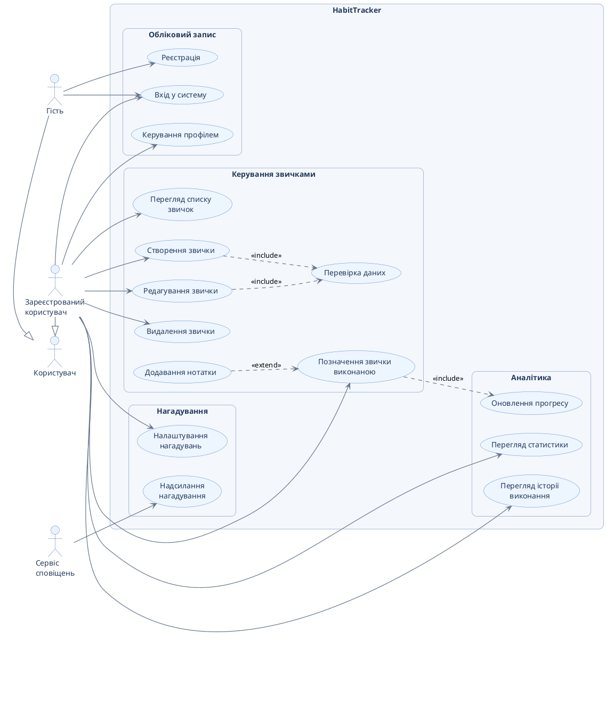

# Лабораторна робота №1
### Огляд CASE-інструментів моделювання та побудова діаграми варіантів використання (Use Case)

**Студент:** Смиковська Анна Володимирівна, ЗІПЗ-23-1

**Предметна область:** Проєктування та розробка інтерактивного вебзастосунку для формування, моніторингу та аналітики персональних звичок.

**Назва системи:** HabitTracker

## 1. Мета роботи

Ознайомитися з інструментами UML-моделювання, визначити акторів і функціональні вимоги до програмної системи, побудувати діаграму варіантів використання та описати основні сценарії взаємодії користувачів із системою.

## 2. Вихідні дані
### 2.1. Опис предметної області

HabitTracker - інтерактивний вебзастосунок, призначений для формування, моніторингу та аналітики персональних звичок.

Система дозволяє користувачам створювати власні звички, налаштовувати параметри та періодичність їх виконання, відстежувати щоденний прогрес, фіксувати виконані дії, переглядати історію та статистику, а також налаштовувати нагадування.

Вебзастосунок забезпечує зручний доступ до персональної інформації через вебінтерфейс і допомагає користувачам формувати корисні звички та контролювати регулярність їх виконання.

### 2.2 Основні функції системи:

1. Реєстрація.
2. Вхід у систему.
3. Керування профілем.
4. Перегляд списку звичок.
5. Створення звички.
6. Редагування звички.
7. Видалення звички.
8. Позначення звички виконаною.
9. Додавання нотатки.
10. Перегляд статистики.
11. Перегляд історії виконання.
12. Налаштування нагадувань.
13. Надсилання нагадування.

## 3. Виконання
### 3.1. Порівняння інструментів моделювання

Для побудови UML-діаграм було розглянуто два інструменти: PlantUML та Astah.

| Критерій | PlantUML | Astah UML |
|---|---|---|
| Зручність інтерфейсу | Робота з текстовим кодом | Графічний інтерфейс |
| Швидкість створення | Висока за наявності досвіду роботи з кодом | Висока завдяки візуальному редагуванню |
| Підтримка UML | Підтримує основні типи UML-діаграм | Підтримує основні типи UML-діаграм |
| Редагування | Зміна текстового коду | Переміщення та редагування графічних елементів |
| Генерація коду | Генерація діаграм із текстового опису | Можливості залежать від редакції та функцій інструмента |
| Інтеграція з AI | Можна використовувати AI для створення PlantUML-коду | Можна використовувати AI для підготовки структури діаграм |
| Вартість | Безкоштовний інструмент | Є безкоштовні та платні редакції |

**Висновок порівняння:** PlantUML зручний для зберігання діаграм у вигляді текстових файлів та інтеграції з Git. Astah забезпечує комфортне графічне редагування UML-моделей. Для подальшої роботи над проєктом основним інструментом обрано PlantUML.

### 3.2. Актори системи

| Актор | Опис |
|---|---|
| User | Базовий актор, який представляє користувача системи. |
| Guest | Неавторизований користувач, який може зареєструватися або увійти в систему. |
| Registered User | Зареєстрований користувач із доступом до основних функцій застосунку. |
| Notification Service | Зовнішній сервіс, який забезпечує надсилання нагадувань. |

### 3.3. Варіанти використання

Варіант використання описує функцію системи, яка забезпечує певну цінність для актора.

У системі HabitTracker визначено такі варіанти використання:

| № | Варіант використання | Актор |
|---|---|---|
| 1 | Реєстрація | Гість |
| 2 | Вхід у систему | Гість, зареєстрований користувач |
| 3 | Керування профілем | Зареєстрований користувач |
| 4 | Перегляд списку звичок | Зареєстрований користувач |
| 5 | Створення звички | Зареєстрований користувач |
| 6 | Редагування звички | Зареєстрований користувач |
| 7 | Видалення звички | Зареєстрований користувач |
| 8 | Позначення звички виконаною | Зареєстрований користувач |
| 9 | Додавання нотатки | Зареєстрований користувач |
| 10 | Перевірка даних | Внутрішня функція системи |
| 11 | Перегляд статистики | Зареєстрований користувач |
| 12 | Перегляд історії виконання | Зареєстрований користувач |
| 13 | Оновлення прогресу | Внутрішня функція системи |
| 14 | Налаштування нагадувань | Зареєстрований користувач |
| 15 | Надсилання нагадування | Сервіс сповіщень |

Під час моделювання використано такі типи зв'язків:
- **Асоціація** — показує взаємодію актора з варіантом використання.
- **include** — позначає обов'язкове включення поведінки одного варіанта використання в інший.
- **extend** — позначає додаткову, необов'язкову поведінку, яка може розширювати основний сценарій.
- **Узагальнення** — показує відношення між загальним актором і його спеціалізованими видами.

### 3.4. Діаграма варіантів використання

Файл діаграми: `lab01_usecase.puml`.

### 3.5. Специфікації варіантів використання
#### 3.5.1. Реєстрація користувача

| Параметр | Опис |
|---|---|
| Назва | Реєстрація користувача |
| ID | UC1 |
| Основний актор | Guest |
| Мета | Створити обліковий запис для використання функцій HabitTracker. |
| Передумови | Користувач не має активного облікового запису. |
| Тригер | Користувач обирає функцію реєстрації. |
| Результат | Обліковий запис успішно створено. |

**Основний сценарій:**
1. Користувач відкриває застосунок.
2. Обирає пункт «Реєстрація».
3. Система відображає форму реєстрації.
4. Користувач вводить ім'я, електронну пошту та пароль.
5. Система перевіряє правильність введених даних.
6. Система перевіряє, чи не зареєстрована така електронна пошта.
7. Система створює обліковий запис.
8. Система повідомляє про успішну реєстрацію.

**Альтернативні сценарії:**
- 5а. Якщо дані введено неправильно, система повідомляє про помилку та пропонує виправити інформацію.
- 6а. Якщо електронна пошта вже використовується, система повідомляє про це користувача.

**Постумови:** Обліковий запис створено, користувач може увійти до системи.

#### 3.5.2. Створення звички

| Параметр | Опис |
|---|---|
| Назва | Створення звички |
| ID | UC2 |
| Основний актор | Registered User |
| Мета | Додати нову звичку до особистого списку користувача. |
| Передумови | Користувач авторизований у системі. |
| Тригер | Користувач обирає функцію створення звички. |
| Результат | Нова звичка збережена в системі. |

**Основний сценарій:**
1. Користувач відкриває розділ звичок.
2. Натискає кнопку «Створити звичку».
3. Система відображає форму створення.
4. Користувач вводить назву та опис звички.
5. Користувач задає частоту виконання.
6. За необхідності користувач налаштовує нагадування.
7. Користувач підтверджує створення.
8. Система перевіряє введені дані.
9. Система зберігає нову звичку.
10. Система відображає оновлений список звичок.

**Альтернативні сценарії:**
- 4а. Якщо назву не вказано, система повідомляє про необхідність заповнення поля.
- 8а. Якщо дані некоректні, система відображає повідомлення про помилку.
- 9а. Якщо збереження не вдалося, система повідомляє про помилку та пропонує повторити операцію.

**Постумови:** Нова звичка збережена та доступна користувачу для подальшого відстеження.

#### 3.5.3. Позначення звички виконаною

| Параметр | Опис |
|---|---|
| Назва | Позначення звички виконаною |
| ID | UC3 |
| Основний актор | Registered User |
| Мета | Зафіксувати виконання певної звички. |
| Передумови | Користувач авторизований і має створену звичку. |
| Тригер | Користувач натискає кнопку позначення виконання звички. |
| Результат | Виконання звички зафіксовано в історії. |

**Основний сценарій:**
1. Користувач відкриває список своїх звичок.
2. Обирає звичку, яку виконав.
3. Натискає кнопку «Виконано».
4. Система перевіряє можливість зафіксувати виконання.
5. Система створює запис про виконання звички.
6. Система оновлює статистику та прогрес користувача.
7. Система відображає оновлений стан звички.

**Альтернативні сценарії:**
- 4а. Якщо звичку вже позначено виконаною за поточний запланований період, система повідомляє про це користувача.
- 5а. Якщо не вдалося зберегти запис, система повідомляє про помилку та пропонує повторити дію.

**Постумови:** Інформація про виконання збережена, а статистика користувача оновлена.

## 4. Використання штучного інтелекту

Під час виконання лабораторної роботи використовувався ChatGPT для допомоги у визначенні функціональних вимог, формуванні акторів, підготовці PlantUML-коду та структуруванні специфікацій варіантів використання.

## 5. Висновки

Під час виконання лабораторної роботи було розглянуто інструменти UML-моделювання PlantUML та Astah UML, створено тестову діаграму класів у кожному з них та порівняно їхні можливості.

Було визначено предметну область вебзастосунку HabitTracker, основних акторів системи та функціональні вимоги до неї.

За допомогою PlantUML побудовано діаграму варіантів використання, яка відображає основні функції системи та взаємодію користувачів із нею. Також підготовлено специфікації трьох основних сценаріїв: реєстрації користувача, створення нової звички та позначення звички виконаною.

У результаті роботи отримано початкову модель вимог до програмної системи, яка буде використовуватися як основа для подальшого проєктування та розробки вебзастосунку.