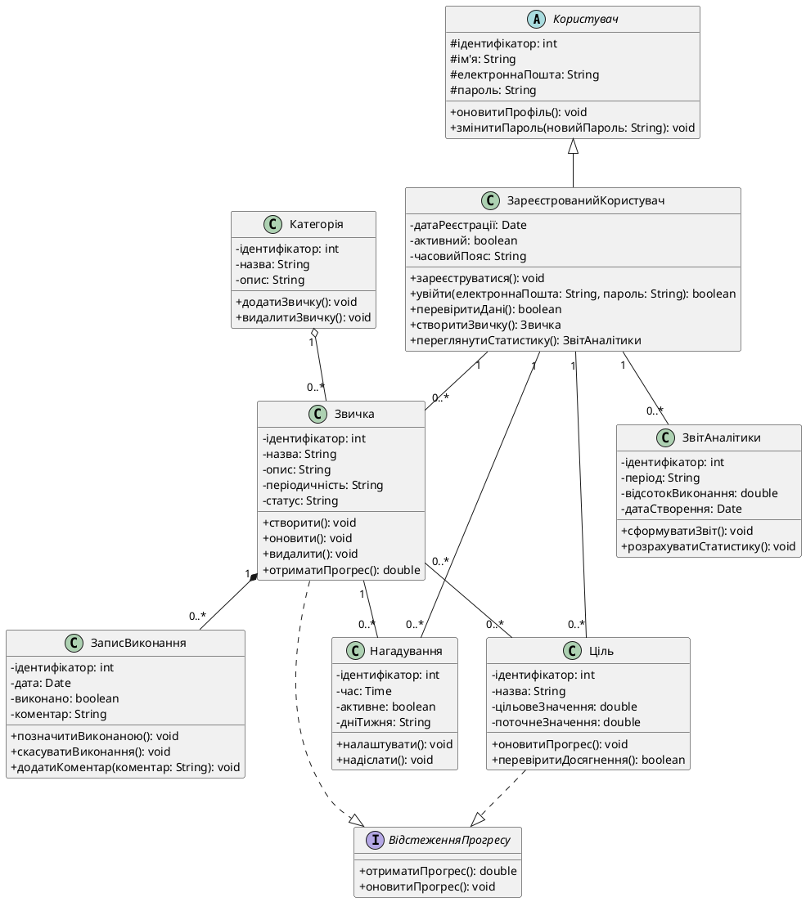

# Лабораторна робота №2
### Побудова діаграми класів предметної області

**Студент:** Смиковська Анна Володимирівна, ЗІПЗ-23-1

**Предметна область:** Проєктування та розробка інтерактивного вебзастосунку для формування, моніторингу та аналітики персональних звичок.

**Назва системи:** HabitTracker

## 1. Мета роботи

Ознайомитися з принципами об'єктно-орієнтованого моделювання програмних систем, навчитися визначати класи, їхні атрибути та методи, а також будувати UML-діаграму класів із використанням різних типів відношень: асоціації, агрегації, композиції, узагальнення та реалізації інтерфейсів.

## 2. Перелік класів та їх призначення

Для моделювання системи **HabitTracker** визначено 8 класів та 1 інтерфейс.

| **Клас** | **Тип** | **Опис** |
| --- | --- | --- |
| `Користувач` | Абстрактний клас | Містить спільні дані та операції користувача системи, зокрема ім’я, електронну пошту та пароль. |
| `ЗареєстрованийКористувач` | Клас (нащадок `Користувач`) | Представляє зареєстрованого користувача, який може створювати звички, керувати профілем і переглядати статистику. |
| `Звичка` | Клас | Описує особисту звичку користувача, її назву, опис, періодичність і поточний статус. |
| `Категорія` | Клас | Об’єднує звички за категоріями та допомагає впорядковувати їх. |
| `ЗаписВиконання` | Клас | Зберігає інформацію про виконання звички за певну дату, зокрема статус виконання та коментар. |
| `Нагадування` | Клас | Містить налаштування нагадувань про виконання звички, включно з часом, активністю та днями тижня. |
| `Ціль` | Клас | Представляє ціль користувача, містить цільове й поточне значення та дає змогу відстежувати прогрес. |
| `ЗвітАналітики` | Клас | Формує статистичну інформацію за обраний період, зокрема відсоток виконання звичок. |
| `ВідстеженняПрогресу` | Інтерфейс | Визначає спільний контракт для класів, які підтримують отримання та оновлення прогресу. |

## 3. Діаграма класів
### 3.1. PlantUML-код діаграми

Файл діаграми: `lab02_classes.puml`.

### 3.2. Використані типи відношень

У діаграмі використано такі типи зв'язків:

- **Асоціація (`--`)** — відображає зв'язки між користувачем, звичками, цілями, нагадуваннями та звітами.
- **Агрегація (`o--`)** — категорія об'єднує звички, але звичка може існувати незалежно від категорії.
- **Композиція (`*--`)** — запис виконання є складовою частиною звички та не має самостійного існування в межах цієї моделі.
- **Узагальнення (`<|--`)** — клас ЗареєстрованийКористувач успадковує властивості та методи абстрактного класу Користувач.
- **Реалізація інтерфейсу (`..|>`)** — класи Звичка та Мета реалізують інтерфейс ПрогресВідстежуваний.

### 3.3. Обґрунтування вибору агрегації та композиції

| Відношення | Тип | Чи має сенс частині існувати без цілого |
| --- | --- | --- |
| Звичка ◆ ЗаписВиконання | Композиція | Ні: запис виконання пов’язаний із конкретною звичкою та не має самостійного значення без неї. Наприклад, запис про виконання звички «Ранкова зарядка» за певну дату не має сенсу окремо від цієї звички. При видаленні звички всі пов’язані з нею записи виконання також видаляються. |
| Категорія ◇ Звичка | Агрегація | Так: звичка може існувати незалежно від категорії. Категорія лише об’єднує звички за спільною ознакою. Якщо категорію видалити, звички можуть залишитися в системі, бути перенесені до іншої категорії або існувати без категорії. |
| ЗареєстрованийКористувач - Звичка | Асоціація (не агрегація/композиція) | Звичка пов’язана з користувачем, який її створив, але не є структурною частиною об’єкта користувача. Вона є окремою сутністю системи, має власні атрибути та методи. Тому між користувачем і звичкою використовується звичайна асоціація. |
| Звичка - Ціль | Асоціація (не агрегація/композиція) | Звичка може бути пов’язана з однією або декількома цілями, а одна ціль може стосуватися декількох звичок. Водночас ціль і звичка є окремими сутностями: видалення однієї з них не обов’язково означає видалення іншої. |

## 4. Перевірка узгодженості з Use Case діаграмою Лабораторної роботи №1

| **Use Case** | **Задіяні класи та методи** |
| --- | --- |
| Реєстрація | `Користувач`, `ЗареєстрованийКористувач` — `зареєструватися()` |
| Вхід у систему | `Користувач`, `ЗареєстрованийКористувач` — `увійти()` |
| Керування профілем | `Користувач`, `ЗареєстрованийКористувач` — `оновитиПрофіль()`, `змінитиПароль()` |
| Перегляд списку звичок | `ЗареєстрованийКористувач`, `Звичка`, `Категорія` |
| Створення звички | `ЗареєстрованийКористувач`, `Звичка` — `створитиЗвичку()`, `створити()` |
| Редагування звички | `Звичка` — `оновити()` |
| Видалення звички | `Звичка` — `видалити()` |
| Позначення звички як виконаної | `Звичка`, `ЗаписВиконання` — `позначитиВиконаною()` |
| Скасування позначки про виконання | `ЗаписВиконання` — `скасуватиВиконання()` |
| Додавання коментаря до виконання | `ЗаписВиконання` — `додатиКоментар()` |
| Перевірка даних під час реєстрації або входу | `ЗареєстрованийКористувач` — `перевіритиДані()` |
| Перегляд статистики | `ЗареєстрованийКористувач`, `ЗвітАналітики` — `переглянутиСтатистику()`, `розрахуватиСтатистику()` |
| Формування аналітичного звіту | `ЗвітАналітики` — `сформуватиЗвіт()` |
| Перегляд історії виконання | `Звичка`, `ЗаписВиконання` |
| Оновлення прогресу | `ВідстеженняПрогресу`, `Звичка`, `Ціль` — `оновитиПрогрес()` |
| Перевірка досягнення цілі | `Ціль` — `перевіритиДосягнення()` |
| Налаштування нагадувань | `ЗареєстрованийКористувач`, `Нагадування` — `налаштувати()` |
| Надсилання нагадування | `Нагадування` — `надіслати()` |

## 5. Висновки

Під час виконання лабораторної роботи 2 побудовано UML-діаграму класів для системи HabitTracker.

Визначено 8 класів та один інтерфейс, описано їхні атрибути, методи та рівні видимості. У діаграмі використано всі основні типи відношень: асоціацію, агрегацію, композицію, узагальнення та реалізацію інтерфейсу.

Також визначено множинність зв'язків між класами та обґрунтовано використання агрегації й композиції. Перевірено відповідність класів основним функціям системи.

У результаті роботи отримано структурну модель системи HabitTracker, яка відображає її основні об'єкти, їхні характеристики, поведінку та взаємозв'язки.