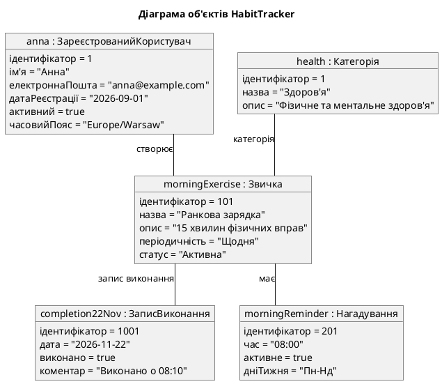
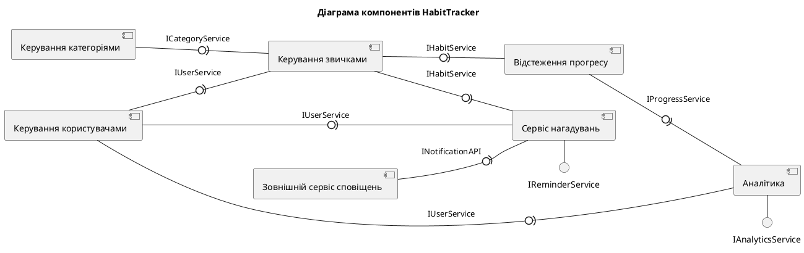
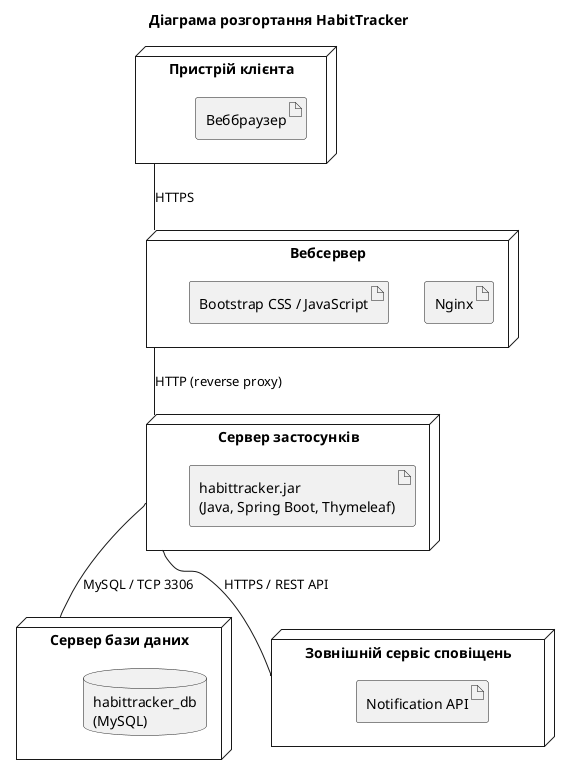

# Лабораторна робота №3
### Побудова діаграм об'єктів, компонентів та розгортання

**Студент:** Смиковська Анна Володимирівна, ЗІПЗ-23-1

**Предметна область:** Проєктування та розробка інтерактивного вебзастосунку для формування, моніторингу та аналітики персональних звичок.

**Назва системи:** HabitTracker

## 1. Мета роботи

Ознайомитися з діаграмами об'єктів, компонентів і розгортання UML, побудувати їх для системи HabitTracker та узгодити з діаграмою класів лабораторної роботи №2.

## 2. Діаграма об'єктів

Для діграми об'єктів обрано п'ять класів із діаграми класів: `ЗареєстрованийКористувач`, `Категорія`, `Звичка`, `ЗаписВиконання` і `Нагадування`. Їхні екземпляри та значення атрибутів демонструють звичку користувача, її категорію, виконання та нагадування.

Лінки відповідають зв'язкам класової діаграми: користувач - звичка, категорія - звичка, звичка - запис виконання та звичка - нагадування. На діаграмі об'єктів вони показані звичайними лінками між екземплярами; кратності й ромби з діаграми класів не дублюються. Для звички показано одне налаштоване нагадування; це відповідає множинності `1 - 0..*` у діаграмі класів.

### 2.1. PlantUML-код діаграми

Файл діаграми: `lab03_object_diagram.puml`.

## 3. Діаграма компонентів

Систему HabitTracker розкладено на шість внутрішніх логічних компонентів-модулів за бізнес-можливостями та зовнішній сервіс сповіщень. Ці модулі входять до одного застосунку на Java та Spring Boot і не розгортаються як окремі мікросервіси. Зв’язки інтерфейсів показані сполучниками ball-and-socket.

| **Компонент** | **Наданий інтерфейс** | **Споживає** |
| --- | --- | --- |
| Керування користувачами | `IUserService` | - |
| Керування звичками | `IHabitService` | `IUserService`, `ICategoryService` |
| Керування категоріями | `ICategoryService` | - |
| Відстеження прогресу | `IProgressService` | `IHabitService` |
| Сервіс нагадувань | `IReminderService` | `IHabitService`, `IUserService`, `INotificationAPI` |
| Аналітика | `IAnalyticsService` | `IProgressService`, `IUserService` |
| Зовнішній сервіс сповіщень | `INotificationAPI` | — |

### 3.1. PlantUML-код діаграми

Файл діаграми: `lab03_component_diagram.puml`.

## 4. Діаграма розгортання

Діаграма визначає п'ять вузлів інфраструктури: пристрій клієнта, вебсервер, сервер застосунків, сервер бази даних і зовнішній сервіс сповіщень. Шість логічних компонентів із попередньої діаграми входять до одного артефакту `habittracker.jar` на основі Java та Spring Boot. Thymeleaf формує HTML-сторінки, а Bootstrap використовується для стилів і клієнтських компонентів. Дані зберігаються в MySQL. Nginx приймає HTTPS-запити та передає їх серверу застосунків.

| **Вузол** | **Розміщені артефакти** |
| --- | --- |
| Пристрій клієнта | Веббраузер |
| Вебсервер | Nginx, Bootstrap (CSS, JavaScript) |
| Сервер застосунків | `habittracker.jar` (Java, Spring Boot, Thymeleaf) |
| Сервер бази даних | `habittracker_db` (MySQL) |
| Зовнішній сервіс сповіщень | Notification API |

Шляхи комунікації підписано протоколами: HTTPS між клієнтом і вебсервером, HTTP між Nginx і Spring Boot (зворотне проксіювання), MySQL/TCP через порт 3306 між застосунком і базою даних, HTTPS/REST API між застосунком і зовнішнім сервісом сповіщень.

### 4.1. PlantUML-код діаграми

Файл діаграми: `lab03_deployment_diagram.puml`.

## 5. Висновки

Під час виконання лабораторної роботи 3 побудовано діаграми об'єктів, компонентів і розгортання системи HabitTracker. Діаграма об'єктів показує конкретний приклад стану системи. Діаграма компонентів пояснює логічну структуру застосунку та взаємодію його модулів. Діаграма розгортання відображає обраний стек Java, Spring Boot, Thymeleaf, Bootstrap і MySQL, розміщення артефактів і протоколи обміну даними.

Діаграма компонентів найкраще пояснює логічну будову системи сторонньому розробнику: вона показує межі відповідальності модулів і контракти між ними. Діаграми об'єктів і розгортання доповнюють її прикладом стану системи та інфраструктурою виконання.