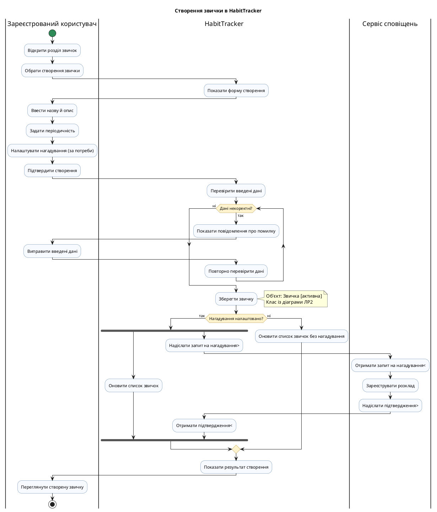

# Лабораторна робота №4
### Побудова діаграми діяльності бізнес-процесу

**Студент:** Смиковська Анна Володимирівна, ЗІПЗ-23-1  

**Предметна область:** вебзастосунок HabitTracker для формування, моніторингу та аналітики персональних звичок  

**Назва системи:** HabitTracker

**Варіант використання:** Створення звички (UC5)

## 1. Мета роботи

Побудувати діаграму діяльності для сценарію створення звички, розподілити дії між учасниками, показати альтернативний потік, цикл перевірки, паралельне налаштування нагадування та перевірити процес за правилами маркерів.

## 2. Специфікація варіанта використання
### 2.1. Створення звички (UC5)

| **Параметр** | **Опис** |
| --- | --- |
| Основний актор | Зареєстрований користувач |
| Мета | Додати нову звичку до особистого списку користувача. |
| Передумови | Користувач авторизований у HabitTracker. |
| Тригер | Користувач обирає функцію створення звички. |
| Результат | Нова звичка збережена та доступна користувачу. |

**Основний потік:** користувач відкриває розділ звичок і обирає створення; система показує форму; користувач вводить назву й опис, задає періодичність та за потреби налаштовує нагадування; користувач підтверджує створення; система перевіряє дані, зберігає звичку й показує оновлений список.

**Альтернативний потік:** якщо дані некоректні або не вказано назву, система повідомляє про помилку. Користувач виправляє дані, після чого система перевіряє їх повторно. Після успішної перевірки сценарій продовжується зі збереження звички.

## 3. Розподіл дій по доріжках

| **Доріжка** | **Роль** | **Дії** |
| --- | --- | --- |
| Зареєстрований користувач | Ініціює створення і вводить дані | Відкрити розділ звичок; обрати створення; ввести назву й опис; задати періодичність; налаштувати нагадування за потреби; підтвердити створення; виправити дані після помилки; переглянути створену звичку. |
| HabitTracker | Керує потоком створення | Показати форму; перевірити дані; показати повідомлення про помилку; повторно перевірити дані; зберегти звичку; оновити список; надіслати запит на нагадування; отримати підтвердження; показати результат створення. |
| Сервіс сповіщень | Реєструє нагадування | Отримати запит; зареєструвати розклад; надіслати підтвердження. |

## 4. Діаграма діяльності

Некоректні дані запускають цикл виправлення та повторної перевірки. Після збереження звички, якщо користувач налаштував нагадування, система паралельно оновлює список і передає запит зовнішньому сервісу сповіщень. Вузол з'єднання очікує завершення обох гілок. Якщо нагадування не налаштовано, система оновлює список без виклику сервісу.

Об'єктний стан `Звичка [активна]` відповідає класу `Звичка` з діаграми класів. Сигнали `Надіслати запит...` та `Надіслати підтвердження` і події `Отримати запит...` та `Отримати підтвердження` показують взаємодію із зовнішнім сервісом.

### 4.1. PlantUML-код діаграми

Файл діаграми: `lab03_activity_diagram.puml`.

## 5. Перевірка відповідності вимогам

| **Вимога** | **Як виконано** |
| --- | --- |
| Обраний варіант використання; основний сценарій не менше 8 кроків і має альтернативу | Створення звички (UC5): основний потік має 10 кроків; передбачено альтернативу для некоректних даних. |
| Не менше трьох доріжок | Три: Зареєстрований користувач, HabitTracker, Сервіс сповіщень. |
| Не менше 12 дій одного рівня абстракції | Понад 12 змістовних дій, кожна описує один крок учасника. |
| Рішення з вичерпними взаємовиключними умовами | Дані некоректні? (так/ні); нагадування налаштовано? (так/ні). Гілки зводяться до спільного потоку. |
| Розгалуження та з'єднання на різних доріжках | Після вибору налаштування нагадування fork запускає оновлення списку в HabitTracker та реєстрацію розкладу в сервісі сповіщень; join очікує обидві гілки. |
| Цикл з явною умовою виходу | Цикл повторної перевірки триває, доки введені дані некоректні; вихід відбувається за умови «ні». |
| Об'єктний вузол зі станом класу з ЛР2 | `Звичка [активна]` після збереження. У текстовому PlantUML цей стан передано приміткою, як дозволяє умова. |
| Сигнал або очікування події | Запит і підтвердження нагадування надсилаються та приймаються у доріжках HabitTracker і Сервісу сповіщень. |
| Таблиці проходження маркера | Наведені нижче для основного сценарію та альтернативи з некоректними даними. |

## 6. Перевірка за правилами маркерів
### 6.1. Основний сценарій: дані коректні, нагадування налаштовано

| **Крок** | **Вузол / дія** | **Маркерів** | **Пояснення** |
| --- | --- | --- | --- |
| 1 | Початковий вузол → відкрити розділ → обрати створення | 1 | Процес стартує з одним маркером. |
| 2 | Показати форму → ввести дані, періодичність і нагадування → підтвердити | 1 | Послідовні дії передають той самий маркер. |
| 3 | Перевірити дані; умова «некоректні?» — ні | 1 | Маркер проходить через вихід із циклу. |
| 4 | Зберегти звичку; об'єктний стан `Звичка [активна]` | 1 | Дані збережено, об'єкт переходить у активний стан. |
| 5 | «Нагадування налаштовано?» — так → fork | 1 → 2 | Fork створює по маркеру для кожної паралельної гілки. |
| 6 | Гілка HabitTracker: оновити список; гілка сервісу: запит → реєстрація → підтвердження | 2 | Обидва маркери просуваються незалежно; кожен доходить до join. |
| 7 | Join | 2 → 1 | З'єднання чекає на обидві гілки, поглинає два маркери й випускає один. |
| 8 | Показати результат → переглянути звичку → кінцевий вузол | 1 → 0 | Основний процес завершується. |

### 6.2. Альтернативний сценарій: дані некоректні

| **Крок** | **Вузол / дія** | **Маркерів** | **Пояснення** |
| --- | --- | --- | --- |
| 1 | Перша перевірка; умова «некоректні?» — так | 1 | Маркер входить у тіло циклу. |
| 2 | Показати помилку → користувач виправляє дані | 1 | Маркер послідовно переходить між доріжками. |
| 3 | Повторно перевірити дані; умова «некоректні?» — ні | 1 | Після виправлення маркер виходить із циклу. |
| 4 | Зберегти звичку → далі за основним потоком | 1 | До паралельної гілки доходить один маркер, зайвих маркерів не залишається. |

### 6.3. Висновок перевірки маркерів

У циклі виправлення діє один маркер, який або повертається на повторну перевірку, або виходить із циклу за умовою «ні». При налаштованому нагадуванні fork створює два маркери, а join чекає на завершення оновлення списку й відповіді сервісу сповіщень. Якщо нагадування не налаштовано, fork не активується і система проходить альтернативною гілкою до спільного результату. Усі маршрути доходять до завершення; вузлів, які чекали б гілку, що не запускалася, немає. Взаємного блокування не виявлено.

## 7. Висновки

Побудовано діаграму діяльності для варіанта використання «Створення звички» системи HabitTracker. Найбільшу увагу приділено коректному циклу повторної перевірки даних і паралельному налаштуванню нагадування. Діаграма узгоджується з функціями та класами `Звичка`, `Нагадування` і `ЗареєстрованийКористувач` з попередніх лабораторних робіт.