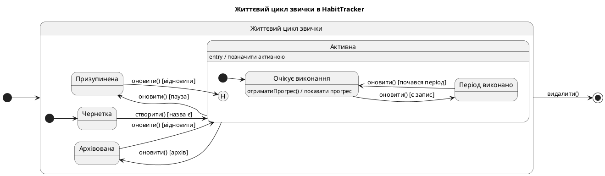

# Лабораторна робота №5
### Побудова діаграми станів об'єкта

**Студент:** Смиковська Анна Володимирівна, ЗІПЗ-23-1 

**Предметна область:** Проєктування та розробка інтерактивного вебзастосунку для формування, моніторингу та аналітики персональних звичок. 

**Обраний клас:** `Звичка`

## 1. Мета роботи

Показати стани об'єкта `Звичка`, можливі переходи між ними та перевірити відповідність подій методам класу.

## 2. Обґрунтування вибору класу

Клас `Звичка` з ЛР2 має атрибут `статус: String` і методи `створити()`, `оновити()`, `отриматиПрогрес()` та `видалити()`. Життєвий цикл звички охоплює створення, виконання за період, призупинення, відновлення, архівування й видалення. Це відповідає функціям HabitTracker.

## 3. Відбір станів і подій

| **Елемент класу `Звичка`** | **Застосування в діаграмі** |
| --- | --- |
| `статус: String` | Зберігає стани «Активна», «Призупинена» та «Архівована». |
| `створити()` | Створює звичку, якщо її назву заповнено. |
| `оновити()` | Змінює стан чи дані звички; охоронні умови розрізняють результати оновлення. |
| `отриматиПрогрес()` | Внутрішній перехід без зміни стану. |
| `видалити()` | Завершує життєвий цикл об'єкта. |

## 4. Діаграма станів

Складений стан **«Життєвий цикл звички»** містить стани «Чернетка», «Активна», «Призупинена» й «Архівована». Усередині складеного стану **«Активна»** є два послідовні підстани: **«Очікує виконання»** та **«Період виконано»**. Пауза зберігає активний підстан через псевдостан історії. Перехід `видалити()` заданий на рівні всього життєвого циклу, тому завершує звичку з будь-якого її стану.

### 4.1. PlantUML-код

Файл діаграми: `lab05_state_diagram.puml`.

## 5. Таблиця станів і переходів

| **З якого стану** | **Подія та умова** | **До якого стану** | **Пояснення** |
| --- | --- | --- | --- |
| Початковий псевдостан | — | Життєвий цикл / Чернетка | Починається життєвий цикл об'єкта. |
| Чернетка | `створити()` `[назва є]` | Активна / Очікує виконання | Створюється звичка з назвою. |
| Очікує виконання | `отриматиПрогрес()` | Очікує виконання | Внутрішній перехід, стан не змінюється. |
| Очікує виконання | `оновити()` `[є запис]` | Період виконано | У поточному періоді зафіксовано виконання. |
| Період виконано | `оновити()` `[новий період]` | Очікує виконання | Починається наступний період. |
| Активна | `оновити()` `[пауза]` | Призупинена | Зберігається активний підстан через історію. |
| Призупинена | `оновити()` `[відновити]` | Історія → попередній підстан | Відновлення повертає звичку до стану перед паузою. |
| Активна | `оновити()` `[архів]` | Архівована | Архівувати можна активну звичку. |
| Архівована | `оновити()` `[відновити]` | Активна / Очікує виконання | Після повернення з архіву починається активний цикл. |
| Будь-який стан життєвого циклу | `видалити()` | Кінцевий псевдостан | Перехід заданий на батьківському складеному стані. |

Умови `[пауза]`, `[відновити]` та `[архів]` — короткі підписи охоронних умов для зміни значення атрибута `статус` через метод `оновити()`.

## 6. Перевірка для двох послідовностей подій

### Послідовність А: призупинення під час очікування
`створити()` → `отриматиПрогрес()` → `оновити()` `[є запис]` → `оновити()` `[новий період]` → `оновити()` `[пауза]` → `оновити()` `[відновити]` → `видалити()`.

| **Крок** | **Подія** | **Стан після події** |
| --- | --- | --- |
| 0 | — | Чернетка |
| 1 | `створити()` `[назва є]` | Активна / Очікує виконання |
| 2 | `отриматиПрогрес()` | Активна / Очікує виконання |
| 3 | `оновити()` `[є запис]` | Активна / Період виконано |
| 4 | `оновити()` `[новий період]` | Активна / Очікує виконання |
| 5 | `оновити()` `[пауза]` | Призупинена |
| 6 | `оновити()` `[відновити]` | Активна / Очікує виконання (повернення через історію) |
| 7 | `видалити()` | Кінцевий псевдостан |

### Послідовність Б: призупинення після виконання
`створити()` → `оновити()` `[є запис]` → `оновити()` `[пауза]` → `оновити()` `[відновити]` → `оновити()` `[архів]` → `видалити()`.

| **Крок** | **Подія** | **Стан після події** |
| --- | --- | --- |
| 0 | — | Чернетка |
| 1 | `створити()` `[назва є]` | Активна / Очікує виконання |
| 2 | `оновити()` `[є запис]` | Активна / Період виконано |
| 3 | `оновити()` `[пауза]` | Призупинена |
| 4 | `оновити()` `[відновити]` | Активна / Період виконано (повернення через історію) |
| 5 | `оновити()` `[архів]` | Архівована |
| 6 | `видалити()` | Кінцевий псевдостан |

## 7. Навмисно відсутній перехід і бізнес-правило

Із стану **«Призупинена»** немає переходу `оновити()` `[є запис]` до **«Період виконано»**: виконання не зараховується, поки звичка призупинена. Також призупинену звичку не можна одразу архівувати — спочатку її потрібно відновити. Це робить зміни прогресу й архівування однозначними та вимагає явного відновлення перед продовженням роботи зі звичкою.

## 8. Узгодженість з діаграмою класів

| **Подія на діаграмі** | **Метод `Звичка`** |
| --- | --- |
| `створити()` | `створити(): void` |
| `оновити()` | `оновити(): void` |
| `отриматиПрогрес()` | `отриматиПрогрес(): double` |
| `видалити()` | `видалити(): void` |

Усі події діаграми відповідають методам класу `Звичка`. Умови визначають, який результат має метод `оновити()` у конкретному стані.

## 9. Висновки

Побудовано діаграму станів звички з чернеткою, активним циклом, призупиненням, відновленням, архівуванням і видаленням. Історія повертає призупинену звичку саме до попереднього підстану. Перевірка двох послідовностей показала, що події ведуть до однозначних станів, а відсутність переходу з паузи до виконаного періоду кодує правило обліку прогресу.