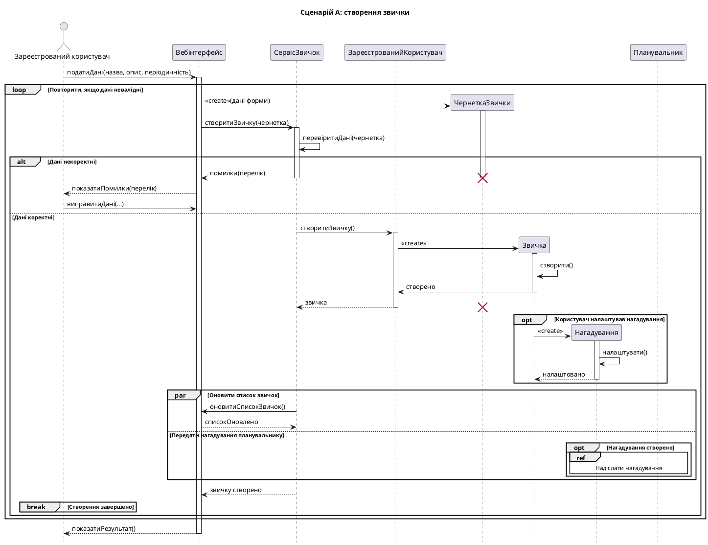
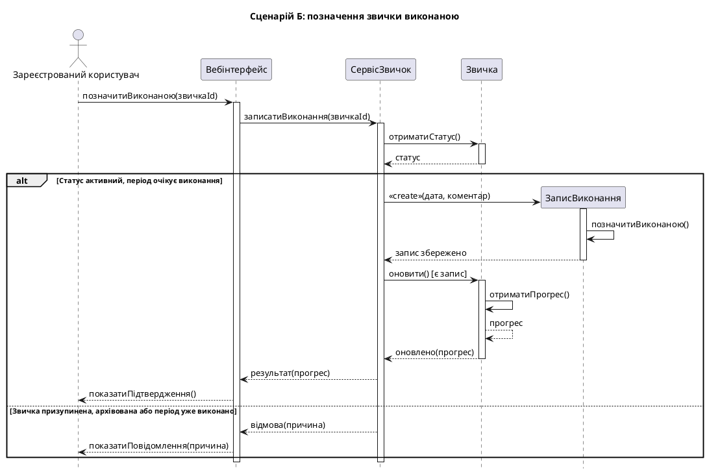
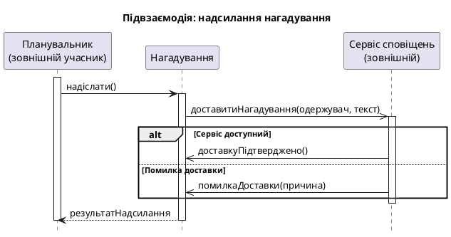

# Лабораторна робота №6
### Побудова діаграм послідовності для ключових сценаріїв системи

**Студент:** Смиковська Анна Володимирівна, ЗІПЗ-23-1 

**Предметна область:** Проєктування та розробка інтерактивного вебзастосунку для формування, моніторингу та аналітики персональних звичок. 

## 1. Мета роботи

Показати взаємодію учасників у двох сценаріях HabitTracker, використати комбіновані фрагменти UML і перевірити узгодженість повідомлень із діаграмою класів та діаграмою станів.

## 2. Вибір сценаріїв та учасників

| Сценарій | Основа з попередніх лабораторних | Основний потік і розгалуження |
| --- | --- | --- |
| А. Створення звички | UC "Створення звички" та сценарій створення з ЛР4 | Перевірка й повторне виправлення даних, за бажанням користувача створюється нагадування. |
| Б. Позначення звички виконаною | UC "Позначення звички виконаною", `Звичка` і `ЗаписВиконання` | Виконання зараховується лише для активної звички, яка ще очікує виконання в поточному періоді. |
| Підвзаємодія для `ref` | UC "Надсилання нагадування", клас `Нагадування` | Планувальник запускає нагадування, сервіс сповіщень повертає результат доставки. |

У діаграмах використано акторів, класи та допоміжні учасники. `Вебінтерфейс`, `СервісЗвичок` і тимчасовий об'єкт `ЧернеткаЗвички` відсутні, їх позначено в таблиці простежуваності як елементи, які треба додати до структурної моделі. Планувальник і сервіс сповіщень є зовнішніми учасниками.

## 3. Діаграми послідовності
### 3.1. Сценарій A - створення звички

Користувач надсилає дані через вебінтерфейс. Сервіс перевіряє їх у циклі: якщо є помилки, показує їх і дозволяє виправити форму, після успішної перевірки зареєстрований користувач створює об'єкт `Звичка`. Нагадування створюється лише за вибором користувача. Оновлення списку та передавання нагадування планувальнику показано як паралельні дії після створення звички.

На діаграмі є `loop`, `alt`, `opt`, `par`, самовиклик перевірки, створення і знищення тимчасової `ЧернеткаЗвички`, а також `ref` на діаграму надсилання нагадування.

### 3.1.1 PlantUML-код

Файл діаграми: `lab06_sequence_a.puml`.

### 3.2. Сценарій B - позначення звички виконаною

Користувач просить зафіксувати виконання. Сервіс отримує поточний стан звички. Якщо вона активна й поточний період ще очікує виконання, створюється `ЗаписВиконання`, викликається `позначитиВиконаною()`, а потім `Звичка.оновити()` переводить її до стану "Період виконано". Метод `отриматиПрогрес()` викликається як внутрішня дія без зміни стану. Для призупиненої, архівованої або вже виконаної за період звички сервіс повертає відмову.

### 3.2.1 PlantUML-код

Файл діаграми: `lab06_sequence_b.puml`.

### 3.3. Підвзаємодія - надсилання нагадування

Це окрема діаграма, на яку посилається `ref` у сценарії А. Зовнішній планувальник викликає `Нагадування.надіслати()`. Нагадування асинхронно передається сервісу сповіщень, альтернативний фрагмент показує підтвердження або помилку доставки.

### 3.3.1 PlantUML-код

Файл діаграми: `lab06_reminder.puml`.

## 4. Простежуваність повідомлень до діаграми класів Лабораторна робота 2

| Діаграма | Повідомлення / отримувач | Відповідність у ЛР2 |
| --- | --- | --- |
| А | `створитиЗвичку()` → `ЗареєстрованийКористувач` | `створитиЗвичку(): Звичка` - є. |
| А | `створити()` → `Звичка` | `створити(): void` - є. |
| А | `налаштувати()` → `Нагадування` | `налаштувати(): void` - є. |
| А | `створитиЗвичку(чернетка)`, `перевіритиДані(чернетка)` → `СервісЗвичок` | Клас і методи відсутні, потрібно додати керівний клас та ці операції. Самовиклик `перевіритиДані()` належить цьому новому класу. |
| А | `податиДані()`, `показатиПомилки()`, `виправитиДані()`, `оновитиСписокЗвичок()`, `показатиРезультат()` → `Вебінтерфейс` | Граничний клас і його методи відсутні, потрібно додати до діаграми класів. |
| А | `<<create>>` / знищення → `ЧернеткаЗвички` | Тимчасовий об'єкт і його тип відсутні в ЛР2, потрібно додати DTO/клас даних форми. `<<create>>` і хрестик знищення - UML-позначення життєвого циклу, не методи класу. |
| А | `<<create>>` → `Звичка`, далі `створити()` | Створення об'єкта - UML-повідомлення, ініціює його наявний метод `ЗареєстрованийКористувач.створитиЗвичку()`, після чого викликається `Звичка.створити()`. |
| А | `<<create>>` / `налаштувати()` → `Нагадування` | Створення - UML-повідомлення, `налаштувати(): void` - є в ЛР2. |
| А | `ref Надіслати нагадування` | Розкривається в окремій діаграмі 3.3, її повідомлення наведені нижче. |
| Б | `отриматиСтатус()` → `Звичка` | Методу немає, потрібно додати `отриматиСтатус(): String` або типізований стан, що дає змогу розрізнити активний, призупинений і архівований об'єкти та поточний підстан. |
| Б | `записатиВиконання()` → `СервісЗвичок`, події UI → `Вебінтерфейс` | Керівний метод і граничні методи відсутні, потрібні додавання з боку ЛР2. |
| Б | `<<create>>` → `ЗаписВиконання` | Клас `ЗаписВиконання` є в ЛР2, повідомлення створення показує появу нового запису. |
| Б | `позначитиВиконаною()` → `ЗаписВиконання` | `позначитиВиконаною(): void` - є. |
| Б | `оновити()` → `Звичка` | `оновити(): void` - є, умова `[є запис]` узгоджується з переходом ЛР5 до "Період виконано". |
| Б | Самовиклик `отриматиПрогрес()` → `Звичка` | `отриматиПрогрес(): double` - є. |
| Б | `результат()`, `відмова()`, показ повідомлень → `СервісЗвичок` / `Вебінтерфейс` | Відповідні методи відсутні, їх потрібно додати до нових керівного та граничного класів. |
| Референс | `надіслати()` → `Нагадування` | `надіслати(): void` - є. |
| Референс | `доставитиНагадування()`, `доставкуПідтверджено()`, `помилкаДоставки()` → зовнішній сервіс / callback | API зовнішнього сервісу не входить до діаграми класів ЛР2, його операції потрібно описати в інтерфейсі інтеграції. |

Пунктирні відповіді на синхронні повідомлення - це повернення результату, а не окремі виклики методів. UML-повідомлення `<<create>>`, знищення лінії життя та рамка `ref` теж не трактуються як методи предметних класів.

## 5. Звірка з діаграмою станів Лабораторна робота 5

| Дія у сценарії Б | Стан / перехід ЛР5 | Результат звірки |
| --- | --- | --- |
| Отримати поточний стан | Потрібен стан об'єкта `Звичка` | Зараз у ЛР2 є атрибут `статус`, але немає методу читання стану, потрібне додавання, позначене в таблиці простежуваності. |
| Створити запис виконання | Запис є передумовою переходу з "Очікує виконання" | Узгоджується з композицією `Звичка`-`ЗаписВиконання` у ЛР2. |
| Викликати `оновити()` за умови `[є запис]` | "Очікує виконання" → "Період виконано" | Перехід існує в ЛР5, послідовність допустима. |
| Викликати `отриматиПрогрес()` | Внутрішня дія в "Очікує виконання" | Метод існує в ЛР2 і не змінює підстан. |
| Виконання в стані "Призупинена" або "Архівована" | Переходу до "Період виконано" немає | Діаграма Б повертає відмову, тож не виконує заборонений перехід. |
| Повторне виконання в стані "Період виконано" в тому самому періоді | Немає переходу `[є запис]`, повернення до очікування можливе з новим періодом | Діаграма Б відмовляє, це відповідає бізнес-правилу ЛР5. |

## 6. Протокол використання ШІ

- **Запит:** допомогти підібрати сценарії для HabitTracker, запропонувати учасників взаємодії та підказати, як показати цикли, розгалуження, паралельні дії й посилання `ref`.
- **Отримана допомога:** ідеї для сценаріїв створення звички та фіксації виконання, а також підказки щодо перевірки взаємодії з класами й діаграмою станів.
- **Перевірка та доопрацювання:** самостійно обрала сценарії доречний, перевірила за ЛР2 і переходи за ЛР5. Відсутні у класовій діаграмі класи й методи позначено як такі, що потребують додавання. Також уточнено порядок створення запису виконання та переходу `Звичка.оновити()`.

ШІ використовувався як помічник для ідей і перевірки.

## 7. Висновки

Підготовлено сценарії створення звички та фіксації її виконання, а підвзаємодію надсилання нагадування винесено окремо. У комплекті використано синхронні й асинхронні повідомлення, повернення, активації, самовиклик, створення та знищення тимчасового об'єкта, фрагменти `alt`, `opt`, `loop`, `par` і `ref`. Звірка з ЛР5 підтверджує дозволений перехід активної звички до виконаного періоду та відмову для призупиненого, архівованого або вже виконаного за період стану. Для повної структурної простежуваності треба додати до ЛР2 граничний клас, сервіс, тип чернетки й метод читання стану, зовнішнє API сповіщень описується окремо.