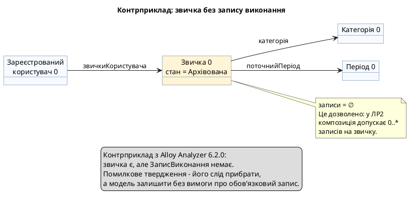
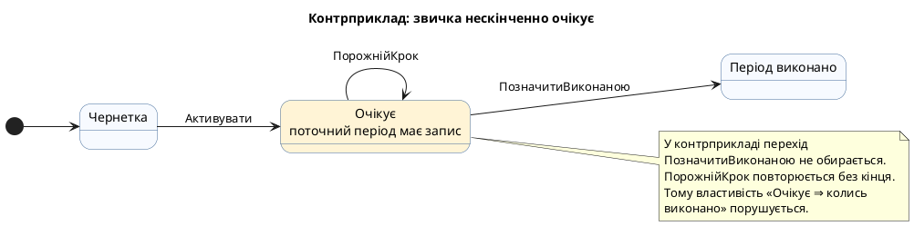
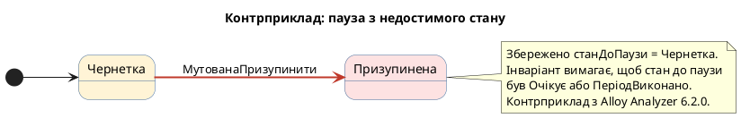
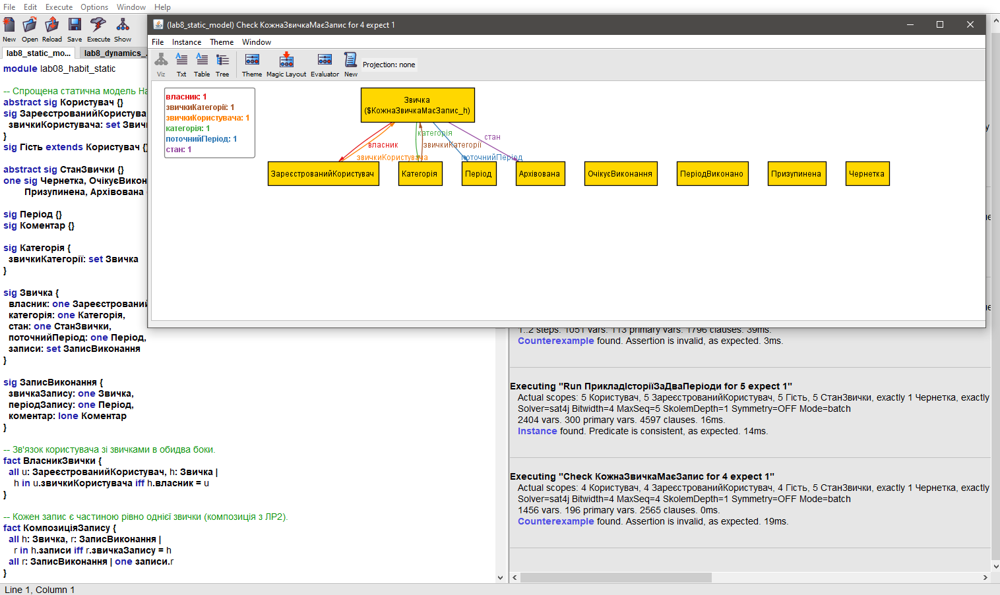
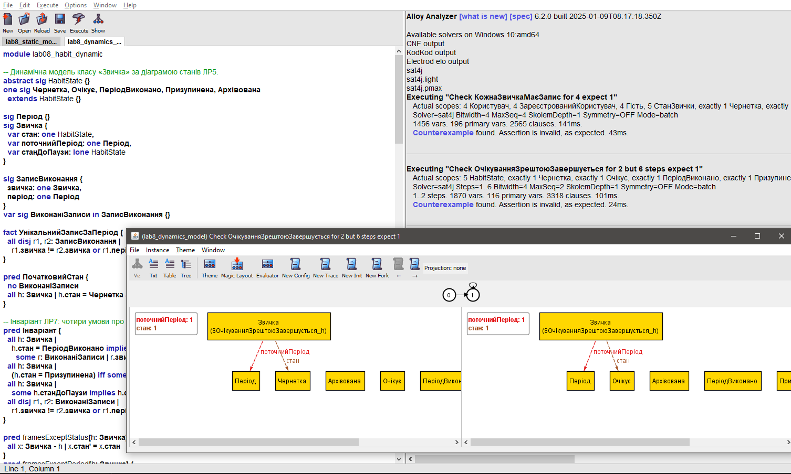
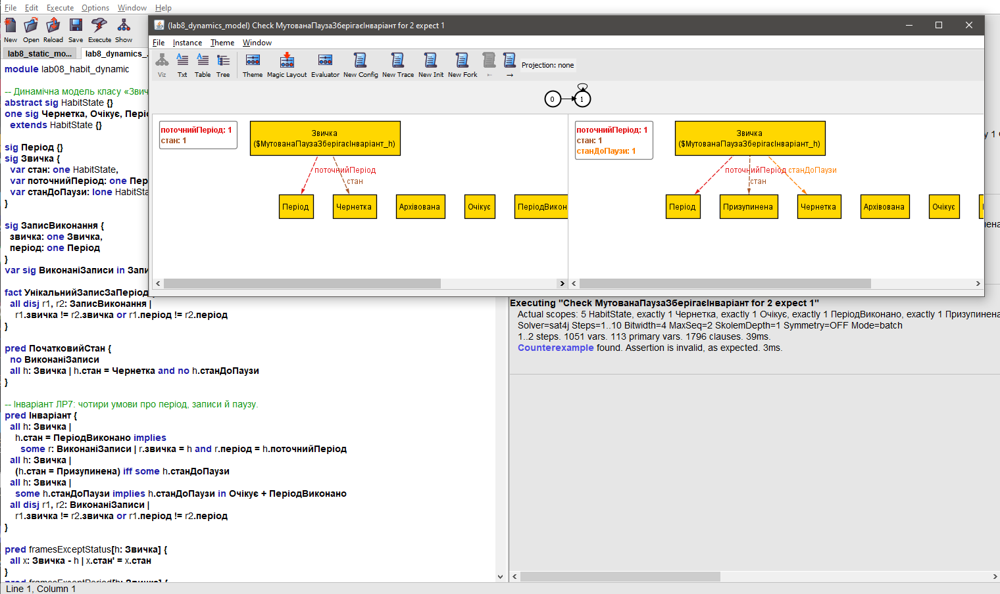
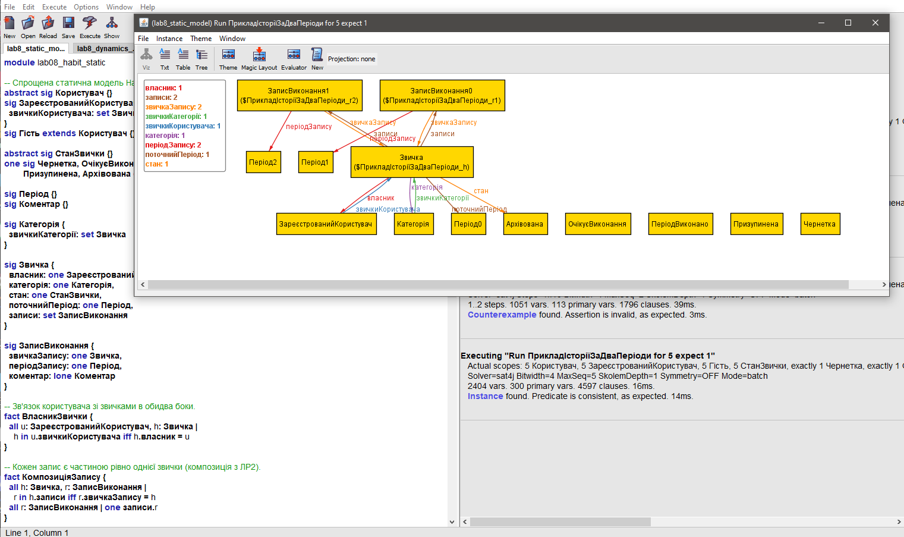

# Лабораторна робота №8
### Формальна специфікація та верифікація моделі в Alloy

**Студент:** Смиковська Анна Володимирівна, ЗІПЗ-23-1 

**Предметна область:** Проєктування та розробка інтерактивного вебзастосунку для формування, моніторингу та аналітики персональних звичок. 

## 1. Мета роботи

Закріпити на практиці матеріал лекції 11 і навчитися автоматично верифікувати моделі власного курсового завдання. Для цього потрібно описати структуру системи мовою Alloy, а поведінку - операціями Alloy 6, що відповідають переходам діаграми станів. Далі слід перевірити в Alloy Analyzer властивості безпеки, досяжності й живучості, проаналізувати знайдені контрприклади та скласти звіт про верифікацію: які суперечності між діаграмою класів, діаграмою станів, діаграмами послідовності та формальною специфікацією попередніх робіт виявлено і як їх треба усунути.

## 1. Частина А. Статична модель

Модель збережена у файлі [lab8_static_model.als](lab8_static_model.als). У ній є абстрактна сигнатура `Користувач` із двома підсигнатурами, `ЗареєстрованийКористувач` і `Гість`, тип стану звички задано перелічуваною множиною `one sig`. Також змодельовано категорію, період, звичку, запис виконання та коментар. Поля використовують множинності `one`, `lone` і `set`.

**Бізнес-правило:** для однієї звички за один період дозволено не більше одного запису виконання. У моделі це задано фактом `ОдинЗаписНаПеріод`. Інші факти зв'язують власника зі звичками, категорію зі звичками та запис зі звичкою відповідно до асоціацій і композиції ЛР2.

### 1.1 Контрприклад до статичного твердження

`КожнаЗвичкаМаєЗапис` має контрприклад: Alloy знаходить звичку без записів виконання. Це не дефект моделі, бо в діаграмі ЛР2 для композиції `Звичка`-`ЗаписВиконання` задано `0..*`. Рішення - не вимагати запису для кожної звички, модель залишено без такої умови.

### 1.1 PlantUML-код

Файл діаграми: `lab8_structure_counterexample_diagram.puml`.

## 2. Частина Б. Динамічна модель

Модель у файлі [lab8_dynamics_model.als](lab8_dynamics_model.als). Змінними є стан звички, її поточний період, стан до паузи та множина виконаних записів. Початковий стан - `Чернетка`. Передбачено сім операцій:

- `Активувати`: чернетка → очікує;
- `ПозначитиВиконаною`: очікує → період виконано;
- `НовийПеріод`: період виконано → очікує з новим періодом;
- `Призупинити` та `Відновити`: пауза зберігає підстан і повертає до нього;
- `Архівувати` та `ВідновитиЗАрхіву`.

Кожна операція має передумову, опис зміни після переходу й умови рамки для незмінених полів. `ПорожнійКрок` зберігає всі поля без змін. Інваріант `Інваріант` перевіряє чотири умови: запис для виконаного поточного періоду, відповідність паузи збереженому стану, допустимий стан до паузи та відсутність повторного запису за пару «звичка–період».

### 2.1 Відповідність операцій діаграмі станів ЛР5

| Операція Alloy | Перехід у діаграмі ЛР5 | Умова виконання | Результат |
|---|---|---|---|
| `Активувати` | `Чернетка → Очікує виконання` | Звичка перебуває у стані `Чернетка` | Стан змінюється на `Очікує` |
| `ПозначитиВиконаною` | `Очікує виконання → Період виконано` | Є невикористаний запис цієї звички для поточного періоду | Запис додається до виконаних, стан змінюється на `ПеріодВиконано` |
| `НовийПеріод` | `Період виконано → Очікує виконання` | Поточний стан - `ПеріодВиконано`, задано інший період | Оновлюється поточний період, стан стає `Очікує` |
| `Призупинити` | `Очікує виконання / Період виконано → Призупинена` | Звичка перебуває в одному з двох активних станів | Попередній стан зберігається в `станДоПаузи` |
| `Відновити` | `Призупинена → збережений активний стан` | Збережено `Очікує` або `ПеріодВиконано` | Відновлюється збережений стан, поле паузи очищується |
| `Архівувати` | `Очікує виконання / Період виконано → Архівована` | Звичка перебуває в одному з двох активних станів | Стан змінюється на `Архівована` |
| `ВідновитиЗАрхіву` | `Архівована → Очікує виконання` | Звичка архівована, задано новий період | Починається новий період у стані `Очікує` |

`ПорожнійКрок` - технічний перехід без зміни стану, потрібний для моделювання трас Alloy, це не окрема бізнес-операція діаграми ЛР5.

## 3. Результати перевірок

Команди запускалися в Alloy Analyzer 6.2.0. `SAT` для `run` означає, що приклад знайдений, `SAT` для `check` - що знайдено контрприклад, `UNSAT` для `check` - що контрприкладу в заданій межі немає. Для двох статичних команд `run` згенеровано по три екземпляри.

| № | Властивість / команда | Вид | Межа | Результат | Висновок |
|---:|---|---|---|---|---|
| 1 | `ПрикладЗвичкиБезЗапису` | `run` | 4 | SAT, 3 екземпляри | Звичка може існувати без історії виконання |
| 2 | `ПрикладІсторіїЗаДваПеріоди` | `run` | 5 | SAT, 3 екземпляри | Для звички можна зберігати записи за різні періоди |
| 3 | `КожнаЗвичкаМаєЗапис` | `check` | 4 | SAT, контрприклад | Твердження надто сильне, модель узгоджена з `0..*` у ЛР2 |
| 4 | `ЗаписНалежитьОднійЗвичці` | `check` | 4 | UNSAT, без контрприкладу | Композиція обмежує запис однією звичкою |
| 5 | `НемаєДубляЗаПеріод` | `check` | 4 | UNSAT, без контрприкладу | Бізнес-правило про один запис за період виконується |
| 6 | `Безпека` - `always Інваріант` | `check` | 2 звички, 5 кроків | UNSAT, без контрприкладу | Операції зберігають інваріант у перевіреній межі |
| 7 | `ДосяжністьУсіхСтанів` | `run` | 2 звички, 10 кроків | SAT | Існує траса, що досягає всіх п'яти станів |
| 8 | `ПовнийСценарій` | `run` | 2 звички, 6 кроків | SAT | Знайдена траса від початкового стану до виконання періоду |
| 9 | `ОчікуванняЗрештоюЗавершується` | `check` | 2 звички, 6 кроків | SAT, контрприклад | Без справедливості можливе нескінченне очікування |
| 10 | `ЖивучістьЗаСправедливості` | `check` | 2 звички, 8 кроків | UNSAT, без контрприкладу | За заданих припущень контрприкладу не знайдено |
| 11 | `МутованаПаузаЗберігаєІнваріант` | `check` | 2 звички | SAT, контрприклад | Вилучення передумови паузи порушує інваріант |

### 3.1 Живучість і припущення

Контрприклад до `ОчікуванняЗрештоюЗавершується`: звичка переходить із чернетки в `Очікує`, після чого порожній крок повторюється нескінченно. У моделі немає правила, яке змушує систему вибрати виконання.

Для умовної живучості прийнято два припущення: користувач надав запис для поточного періоду, а система не відкладає назавжди постійно доступну операцію фіксації. Це відповідає звичайній роботі трекера: без введеного користувачем виконання нічого позначати, а отриманий запис система має обробити.

### 3.2 PlantUML-код

Файл діаграми: `lab8_liveness_counterexample_diagram.puml`.

### 3.3 Мутаційний експеримент

У предикаті `ПризупинитиМутовано` вилучено умову передумови, яка дозволяє паузу лише зі станів `Очікує` або `ПеріодВиконано`. Alloy знаходить перехід `Чернетка → Призупинена`, де `станДоПаузи = Чернетка`. Це порушує інваріант, бо відновлюваний стан має бути активним. Правильну передумову залишено в операції `Призупинити`.

### 3.4 PlantUML-код

Файл діаграми: `lab8_mutation_counterexample_diagram.puml`.

## 4. Узгодженість із попередніми моделями

| Попередня модель | Що узгоджено | Розбіжність, тип і рішення |
|---|---|---|
| ЛР2 - діаграма класів | Класи `Звичка` й `ЗаписВиконання`, власник, категорія та композиція записів | У ЛР2 `статус: String`, а тут він перелічений, **дефект типізації** - замінити рядок на перелік станів. Alloy додає `Гість` як другу підсигнатуру абстрактного `Користувач` для вимоги ЛР8, **свідоме розширення** - за потреби додати клас до UML. |
| ЛР2 - категорія | У моделі кожна звичка має одну категорію, як у множинності UML | Пояснення до ЛР2 допускає звичку без категорії, хоча діаграма ставить `1`, **питання до замовника** - уточнити, чи категорія обов'язкова, і привести текст та UML до одного правила. |
| ЛР4 - діаграма діяльності | Ураховано створення, перевірку й появу звички | ЛР4 показує створення одразу активної звички, а ЛР5 починає з чернетки, **неузгодженість моделей** - додати в діяльність явний перехід із чернетки до активного стану. Повторну перевірку форми й нагадування Alloy свідомо не моделює. |
| ЛР5 - діаграма станів | Стани й переходи очікування, виконання, паузи, архіву та відновлення відображені | Відновлення з архіву починає новий період в `Очікує`, підстан у ЛР5 не уточнено, **свідоме рішення для формалізації** - зафіксувати це як правило. |
| ЛР6 - діаграми послідовності | Позначення виконання можливе з активного стану очікування, невідповідні стани відхиляються | Створення об'єкта-запису й коментар не деталізовані, **свідоме спрощення** - перевіряються лише зв'язок запису, період і стан. |
| ЛР7 - Z-специфікація | Збережено умову виконаного поточного періоду, паузу та максимум один запис за період | Alloy обмежує лише властивості, потрібні для перевірок ЛР8, решта полів і помилкових відповідей Z не відтворюється, **свідоме спрощення** - розширювати модель лише для нових перевірок. |

## 5. Контрприклади

Структурний контрприклад показує звичку без записів: саме такий стан дозволений множинністю `0..*` у ЛР2. Контрприклад живучості показує звичку в стані очікування з нескінченним порожнім кроком. Контрприклад мутації показує заборонений перехід із чернетки в паузу.

### Скриншоти з Alloy Analyzer

**Структурний контрприклад:** звичка існує без запису виконання.

**Контрприклад живучості:** траса переходить у стан очікування й повтрює його.

**Мутаційний контрприклад:** звичка переходить з чернетки в паузу.

**Приклад історії:** два записи звички належать різним періодам.

## 6. Висновок

Статичну й динамічну моделі HabitTracker перевірено в Alloy Analyzer 6.2.0. У заданих межах знайдено передбачені приклади й контрприклади, інваріант зберігається, а умовна живучість виконується за явно зазначених припущень. Також порівняно фрагмент із діаграмами класів, діяльності, станів, послідовностей і Z-специфікацією попередніх лабораторних.